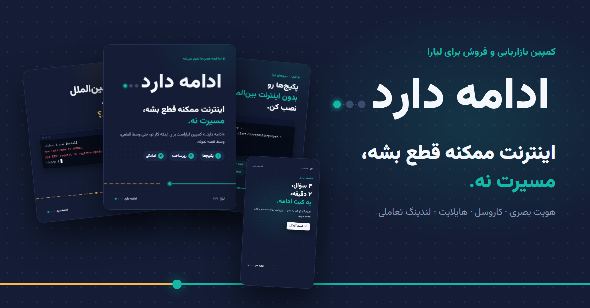

# ادامه دارد… — کمپین لیارا

> **اینترنت ممکنه قطع بشه، مسیرت نه.**

کمپین سرفصلی بازاریابی و فروش برای [لیارا](https://liara.ir/) با موضوع معرفی راهکارها در شرایط محدودیت یا قطعی اینترنت بین‌الملل. پروژه‌ی کلاس «کمپین بازاریابی و فروش».



## ایده در یک نگاه

«ادامه دارد…» جمله‌ی پایان هر قسمت سریال است: قصه قطع شده، ولی تمام نشده. در هویت کمپین، سه‌نقطه‌ی آن دو نقطه‌ی خاموش (اتصال‌های قطع‌شده) و یک نقطه‌ی روشن فیروزه‌ای (کاری که با لیارا ادامه پیدا می‌کند) دارد.

جزئیات کامل در [docs/strategy.md](docs/strategy.md).

## خروجی‌ها

| # | خروجی | مسیر |
|---|---|---|
| ۱ | پست اسلایدی اینستاگرام (۹ اسلاید، ۱۰۸۰×۱۳۵۰) | [carousel/export/](carousel/export/) · [کپشن](carousel/caption.md) |
| ۲ | هایلایت‌ها (۵ کاور + ۱۱ استوری، ۱۰۸۰×۱۹۲۰) | [highlights/export/](highlights/export/) |
| ۳ | لندینگ تعاملی با تست آمادگی | [landing/](landing/) |
| ۴ | هویت بصری | [brand/guide.html](brand/guide.html) · [لوگوها](brand/) |
| ۵ | پست لینکدین | [linkedin/post.md](linkedin/post.md) · [کاور](linkedin/linkedin-cover.png) |

صفحه‌ی [index.html](index.html) همه‌ی خروجی‌ها را یک‌جا نشان می‌دهد.

## اجرا

همه‌چیز HTML/CSS/JS ساده و بدون وابستگی خارجی است. فونت [وزیرمتن](https://github.com/rastikerdar/vazirmatn) (OFL) در `assets/fonts` قرار دارد.

```bash
# مشاهده‌ی محلی
python -m http.server 8000   # سپس http://localhost:8000

# خروجی گرفتن دوباره‌ی PNGها (Chrome لازم است)
tools/export-carousel.sh
tools/export-highlights.sh
tools/shot.sh linkedin/cover.html linkedin/linkedin-cover.png 1200 627
```

## ساختار

```
assets/      توکن‌های طراحی و فونت‌ها
brand/       لوگوتایپ (SVG منحنی‌شده) و راهنمای هویت
carousel/    منبع HTML اسلایدها، خروجی PNG، کپشن
highlights/  منبع HTML کاورها و استوری‌ها، خروجی PNG
landing/     لندینگ کمپین
linkedin/    کاور و متن پست
docs/        سند استراتژی
tools/       اسکریپت‌های خروجی
```

---

این مخزن یک پروژه‌ی آموزشی است و وب‌سایت یا کانال رسمی لیارا نیست. اطلاعات خدمات از liara.ir گرفته شده و پیش از انتشار رسمی باید توسط لیارا تأیید شود.
