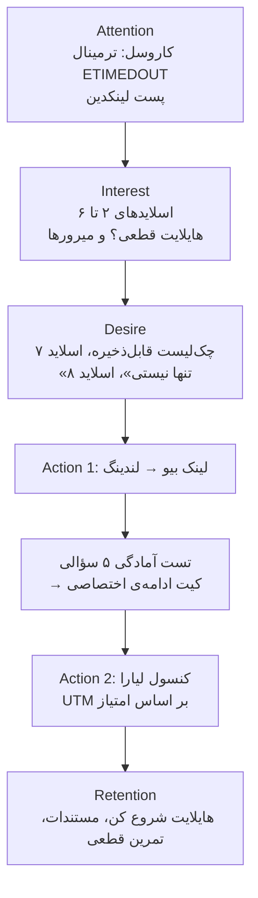

# کمپین لیارا: «ادامه دارد…»

> **شعار:** اینترنت ممکنه قطع بشه، مسیرت نه.
> **امضا:** لیارا؛ کنار تو، حتی در روزهای سخت.

این سند نسخه‌ی تکامل‌یافته‌ی [liara_campaign_vasl_edame.md](../liara_campaign_vasl_edame.md) است. استراتژی پایه (قیف، مخاطب، تست آمادگی، صداقت فنی) حفظ شده و چهار چیز اضافه یا تیز شده است: ایده‌ی بزرگ و نام، تمرکز روی میرورها، مخاطب اصلی واحد، و لندینگی که ادعای کمپین را خودش اجرا می‌کند.

---

## ۱. از اینسایت تا ایده

| لایه | محتوا |
|---|---|
| **واقعیت** | در قطعی‌های اینترنت بین‌الملل، کسب‌وکارهای دیجیتال ایران متوقف شدند؛ نه فقط به خاطر سرور خارجی، بلکه به خاطر وابستگی‌های پنهان: پکیج‌ها، ایمیج‌های داکر، CDN، فونت، API. |
| **اینسایت** | آدم‌ها از «قطعی» نمی‌ترسند؛ از **وسط کار ماندن** می‌ترسند. و بیشترشان نمی‌دانند دقیقاً کجای کارشان به بیرون وصل است. |
| **ایده‌ی بزرگ** | **«ادامه دارد…»**؛ جمله‌ی آشنای پایان هر قسمت سریال. قصه قطع شده، اما تمام نشده. سه‌نقطه‌اش هم شکل لودینگ و انتظار است. |
| **پیام واحد (SMP)** | کار تو می‌تواند ادامه پیدا کند، اگر از امروز وابستگی‌هایش را بشناسی و روی زیرساخت داخلی آماده‌اش کنی. |
| **دلیل باور (RTB)** | میرورهای لیارا («بدون نیاز به اینترنت بین‌الملل»)، دیتاسنترهای داخل ایران، بکاپ رایگان تا ۱۰ برابر فضای پلن، DNS رایگان، پرداخت ساعتی، ۲۰۰ هزار+ توسعه‌دهنده. |

### چرا این ایده؟

- **فرهنگی و فوری فهمیده می‌شود:** همه «ادامه دارد…» را از تلویزیون می‌شناسند؛ نیاز به توضیح ندارد.
- **امید، نه ترس:** کمپین درباره‌ی بحران نیست، درباره‌ی ادامه است؛ با برند «همراه» لیارا هم‌خوان است.
- **قابل‌تبدیل به سیستم بصری:** سه‌نقطه (دو خاموش، یکی روشن) در لوگو، فاوآیکون، فوتر هر اسلاید، کاور هایلایت و حتی پایان قیف (هر سه روشن: «ادامه‌اش با تو») تکرار می‌شود.
- **روایت سریالی برای کاروسل:** هر اسلاید با «ادامه دارد…» تمام می‌شود و انگیزه‌ی ورق‌زدن می‌سازد.
- **فنی و صادق:** ادعای «همیشه وصل» نمی‌دهیم؛ ادعای «آماده‌تر و کم‌وابسته‌تر» می‌دهیم که قابل‌اثبات است.

---

## ۲. مخاطب

| | مخاطب | دغدغه | نقش در کمپین |
|---|---|---|---|
| **اصلی** | توسعه‌دهنده‌ها و تیم‌های فنی (فریلنسر تا CTO استارتاپ) | `npm install` و `docker pull` کار نمی‌کند؛ سرور خارجی در دسترس نیست | همه‌ی کاروسل و هایلایت‌ها با زبان و تصویر آن‌ها (ترمینال) ساخته شده |
| **ثانویه** | صاحبان فروشگاه اینترنتی | توقف فروش، درگاه و پیامک | بخش «کار تو چیه؟» لندینگ + آیتم اختصاصی در کیت ادامه |
| **ثانویه** | مدیران IT سازمان‌ها | تداوم سرویس، بکاپ و بازیابی | بخش «سامانه‌ی سازمانی» لندینگ |

**لحن:** صمیمی و محاوره‌ای («تو»)، رک، فنی، آرام. نمی‌ترسانیم؛ آماده می‌کنیم.

---

## ۳. سه ستون پیام (و نقشه‌ی محصول)

| ستون | پیام | محصولات لیارا |
|---|---|---|
| ۱. پکیج‌ها | پکیج‌ها رو بدون اینترنت بین‌الملل نصب کن. | میرورها: npm، PyPI، Docker Hub، Composer، Go، NuGet، GitHub، مخزن‌های لینوکس |
| ۲. زیرساخت | کد، داده و فایل‌هات، کنار هم داخل ایران. | پلتفرم (PaaS)، دیتابیس ابری، ذخیره‌سازی ابری، سرور مجازی ابری |
| ۳. آمادگی | آمادگی یعنی قبل از قطعی تمرین کنی. | بکاپ رایگان، DNS رایگان، ایمیل SMTP، پرداخت ساعتی (محیط تمرین ارزان) |

> ستون اول عمداً «ورودی کم‌ریسک» است: تنظیم یک خط و بدون مهاجرت. این اولین تجربه‌ی موفق مخاطب با لیاراست و دروازه‌ی ستون‌های بعدی.

---

## ۴. قیف و مسیر مخاطب (AIDA)

| مرحله | نقطه‌ی تماس | محرک حرکت به مرحله‌ی بعد |
|---|---|---|
| آگاهی | اسلاید ۱ کاروسل، پست لینکدین | قلاب «کار تو چی؟» + فوتر «ادامه دارد…» |
| علاقه | اسلایدهای ۲ تا ۶، هایلایت‌های «قطعی؟» و «میرورها» | راهکار مشخص و قابل‌امتحان (دستور یک‌خطی) |
| تمایل | اسلاید ۷ (چک‌لیست، برای Save)، اسلاید ۸ (همراهی) | «کیت ادامه‌ی مخصوص کارت» در اسلاید ۹ |
| اقدام | لندینگ: تست آمادگی، انتخاب نوع کسب‌وکار | CTAهای شخصی‌شده در کیت ادامه |
| تبدیل | کنسول لیارا | پرداخت ساعتی = ریسک پایین برای امتحان |
| وفاداری | هایلایت «شروع کن»، مستندات، تمرین قطعی | آمادگی تمرین‌شونده است، نه یک‌باره |

---

## ۵. خروجی‌ها و نقش هر کدام

| خروجی | فایل | نقش در قیف |
|---|---|---|
| هویت بصری | `brand/guide.html`، `brand/logo-*.svg` | یکپارچگی همه‌ی نقاط تماس |
| کاروسل ۹ اسلایدی | `carousel/export/slide-01..09.png` + `caption.md` | آگاهی → تمایل |
| ۵ هایلایت + ۱۱ استوری | `highlights/export/` | آرشیو همیشگی: آموزش و هدایت به لندینگ |
| لندینگ تعاملی | `landing/` | تبدیل |
| پست لینکدین | `linkedin/post.md` + `linkedin-cover.png` | آگاهی در شبکه‌ی حرفه‌ای + روایت پشت کمپین |

### ساختار کاروسل

| # | تیتر | هدف | خط سراسری |
|---|---|---|---|
| ۱ | اینترنت بین‌الملل قطع شد. کار تو چی؟ | قلاب | کهربایی، گسسته |
| ۲ | قطعی فقط یعنی «سایت بالا نمیاد»؟ نه. | مسئله | کهربایی، گسسته |
| ۳ | ادامه دارد… / مسیرت نه. | معرفی کمپین | نقطه‌ی چرخش |
| ۴ | پکیج‌ها رو بدون اینترنت بین‌الملل نصب کن. | ستون ۱ | فیروزه‌ای |
| ۵ | کد، داده و فایل‌هات کنار هم، داخل ایران. | ستون ۲ | فیروزه‌ای |
| ۶ | آمادگی یعنی قبل از قطعی تمرین کنی. | ستون ۳ | فیروزه‌ای |
| ۷ | چک‌لیست قبل از قطعی بعدی | ارزش قابل‌ذخیره | فیروزه‌ای |
| ۸ | تو روزهای سخت، تنها نیستی. | اعتماد و همراهی | فیروزه‌ای |
| ۹ | کار تو چقدر برای بروز شرایط قطعی اینترنت آماده‌ست؟ | CTA | هر سه نقطه روشن |

یک خط افقی از همه‌ی اسلایدها عبور می‌کند؛ در ورق‌زدن، مخاطب «گسست» را به «ادامه» تبدیل‌شده می‌بیند.

### هایلایت‌ها

| هایلایت | استوری‌ها | اقدام |
|---|---|---|
| قطعی؟ | چه چیزی از کار می‌افتد + نظرسنجی | ادامه به میرورها |
| میرورها | مخزن‌ها، دستور npm/pip، تنظیم Docker | راهنمای میرورها |
| زیرساخت | محصولات داخل ایران، پرداخت ساعتی و بکاپ | کنسول |
| آماده‌ای؟ | تست آمادگی (لینک)، چک‌لیست | لندینگ |
| شروع کن | سه قدم تا استقرار، شعار پایانی | لندینگ / کنسول |

### لندینگ

Hero (ترمینال زنده) ← «در قسمت قبل…» (مسئله) ← سه قدم تا ادامه (دستورهای قابل‌کپی) ← کار تو چیه؟ (سه نوع کسب‌وکار) ← تست آمادگی و کیت ادامه ← تنها نیستی ← FAQ صادقانه ← «قسمت بعدی رو خودت بنویس».

**اثبات عملی:** لندینگ هیچ وابستگی خارجی ندارد و تعداد درخواست‌های خارجی را زنده با Performance API نمایش می‌دهد.

---

## ۶. سنجش (KPI)

| مرحله | شاخص | ابزار |
|---|---|---|
| آگاهی | Reach، Impression، Save اسلاید ۷ | Instagram Insights |
| علاقه | CTR لینک بیو، بازدید هایلایت‌ها | Insights + UTM |
| اقدام | نرخ شروع و تکمیل تست (`quiz_start` / `quiz_complete`) | رویدادهای `dataLayer` |
| تبدیل | کلیک CTA کنسول به تفکیک امتیاز (`utm_content=quiz_result_X`) | UTM + آنالیتیکس لیارا |
| وفاداری | ثبت‌نام، اولین استقرار، استفاده از میرور | داده‌ی داخلی لیارا |

لندینگ رویدادها را در `window.dataLayer` می‌گذارد و خودش چیزی به جایی ارسال نمی‌کند؛ اتصال به ابزار آنالیتیکس (ترجیحاً داخلی) با تیم لیارا.

---

## ۷. اجرا (۴ هفته)

| هفته | فعالیت |
|---|---|
| ۱ | تأیید ادعاهای فنی با تیم لیارا، نهایی‌سازی متن‌ها، راه‌اندازی لندینگ |
| ۲ | انتشار کاروسل + پست لینکدین، فعال‌سازی هایلایت‌ها |
| ۳ | استوری‌های روزانه از هایلایت‌ها، نظرسنجی «قطعی قبلی کارت ادامه داشت؟»، بازنشر چک‌لیست |
| ۴ | تحلیل قیف، بهینه‌سازی CTA، محتوای «تمرین قطعی» برای کاربران فعال |

### تقسیم وظایف

| نقش | مسئولیت |
|---|---|
| استراتژیست | اینسایت، پیام واحد، قیف، KPI |
| کپی‌رایتر | شعار، متن اسلاید، استوری، لندینگ، لینکدین |
| طراح | هویت بصری، کاروسل، کاور هایلایت |
| توسعه‌دهنده | لندینگ، تست آمادگی، رویدادهای تحلیلی |
| انتشار و تحلیل | زمان‌بندی، پایش، گزارش |

---

## ۸. ملاحظات صداقت فنی

- هیچ ادعای «۱۰۰٪ در دسترس» یا «همیشه وصل» در کمپین نیست.
- درباره‌ی API هوش مصنوعی در زمان قطعی وعده داده نمی‌شود (به ارائه‌دهنده‌های خارجی وابسته است).
- درگاه پرداخت، پیامک و APIهای خارجی به‌عنوان «جدا بررسی کن» معرفی شده‌اند.
- دستورهای میرور عیناً از صفحه‌های رسمی liara.ir/mirrors برداشته شده‌اند.
- رایگان بودن میرورها ادعا نشده است (در صفحات بررسی‌شده ذکر نشده بود).
- امتیاز تست آمادگی یک خودارزیابی سریع است و این در خود نتیجه نوشته شده است.
- همه‌ی ادعاها باید پیش از انتشار رسمی توسط تیم لیارا تأیید شوند.
