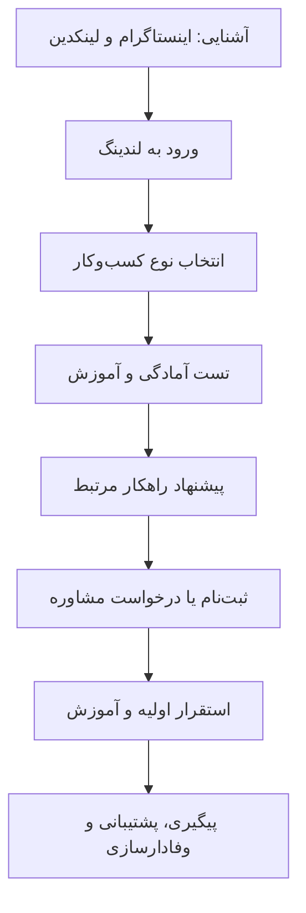

# کمپین بازاریابی و فروش لیارا: «وصلِ ادامه»

> **شعار اصلی:** اینترنت ممکنه قطع بشه، مسیرت نه.  
> **پیام برند:** لیارا؛ همراه کسب‌وکار تو، حتی در روزهای سخت.

## ۱. خلاصه اجرایی

کمپین «وصلِ ادامه» با محور **آمادگی و تداوم فعالیت دیجیتال در شرایط محدودیت یا قطعی اینترنت بین‌الملل** طراحی شده است. هدف، فراتر رفتن از چند پست تبلیغاتی و ساختن مسیری منسجم از آگاهی تا اقدام عملی و استفاده از خدمات لیاراست.

**ایده مرکزی:** نمایش مسیر کسب‌وکار به شکل خطی پیوسته که با وجود اختلال‌های محیطی، با برنامه‌ریزی، کاهش وابستگی‌های خارجی و انتخاب زیرساخت مناسب ادامه پیدا می‌کند.

**ملاحظه فنی:** هیچ زیرساختی به‌تنهایی ادامه فعالیت همه سرویس‌ها را در هر سناریوی قطعی تضمین نمی‌کند. دسترسی کاربران، DNS، درگاه پرداخت، سرویس پیامک، APIهای خارجی و سایر وابستگی‌ها باید به‌طور جداگانه ارزیابی و آزمایش شوند. ادعاهای مربوط به عملکرد خدمات لیارا در شرایط قطع اینترنت باید پیش از انتشار توسط تیم فنی برند تأیید شوند.

## ۲. شناخت برند و راهکارهای قابل معرفی

وب‌سایت رسمی: https://liara.ir/

| قابلیت | کاربرد پیشنهادی در کمپین |
|---|---|
| استقرار اپلیکیشن / PaaS | میزبانی و اجرای برنامه در زیرساخت مناسب |
| پایگاه داده ابری / DBaaS | نگهداری داده در کنار سرویس‌های برنامه |
| سرور مجازی ابری | کنترل بیشتر بر محیط اجرا و پیکربندی |
| فضای ذخیره‌سازی آبجکت | مدیریت فایل‌ها و دارایی‌های دیجیتال |
| DNS | مدیریت دامنه و مسیرهای دسترسی |
| پشتیبان‌گیری و پایش | آمادگی برای بازیابی و تشخیص اختلال، در صورت پشتیبانی سرویس انتخابی |
| مستندات و پشتیبانی | آموزش و راهنمایی فنی برای آماده‌سازی |

> فهرست ویژگی‌ها و جزئیات فنی/تجاری باید با مستندات به‌روز لیارا و تأیید تیم محصول نهایی شود.

## ۳. استراتژی کمپین

### اهداف

1. **آگاهی (Awareness):** معرفی اهمیت آمادگی برای محدودیت ارتباطات و شناساندن راهکارهای لیارا.
2. **بررسی و اعتمادسازی (Consideration):** ارائه چک‌لیست، سناریو و آموزش قابل‌آزمایش.
3. **تبدیل (Conversion):** هدایت مخاطب به ثبت‌نام، استقرار اولیه یا درخواست مشاوره.
4. **وفادارسازی (Retention):** همراهی با محتوای آموزشی و پشتیبانی در مسیر آمادگی.

### مخاطبان هدف

| گروه | دغدغه | پیام اختصاصی |
|---|---|---|
| توسعه‌دهندگان و تیم‌های فنی | API، دیتابیس، استقرار و وابستگی خارجی | «قبل از اختلال، وابستگی‌های برنامه‌ات رو بشناس.» |
| فروشگاه‌های اینترنتی و استارتاپ‌ها | توقف فروش و اختلال در سفارش‌ها | «کسب‌وکارت برای روزهای سخت هم برنامه داشته باشه.» |
| مدیران IT و شرکت‌های نرم‌افزاری | پایداری، بازیابی و کاهش ریسک | «تداوم سرویس، از طراحی زیرساخت شروع می‌شه.» |

### دلیل انتخاب ایده

- **احساسی:** پیام همراهی و تنها نماندن مخاطب.
- **کاربردی:** تبدیل نگرانی به چک‌لیست و اقدام مشخص.
- **فنی:** پیوند مفهوم کمپین با معماری و زیرساخت واقعی.
- **تجاری:** ساختن مسیر مشخص از محتوای آموزشی به ثبت‌نام و استفاده از خدمات.

## ۴. هویت بصری

**نام:** وصلِ ادامه  
**شعار:** اینترنت ممکنه قطع بشه، مسیرت نه.  
**امضای برند:** لیارا؛ همراه کسب‌وکار تو، حتی در روزهای سخت.

### ایده تصویری

یک خط نورانی پیوسته از میان بخش‌های گسسته شبکه عبور می‌کند؛ خط نماد تداوم فعالیت است، نه ادعای اتصال همیشگی اینترنت.

### پالت پیشنهادی

| رنگ | کد | کاربرد |
|---|---|---|
| سرمه‌ای | `#141D35` | پس‌زمینه و حس اعتماد |
| فیروزه‌ای | `#13B8A6` | مسیر پیوسته و عناصر تعاملی |
| کهربایی | `#F6B94C` | هشدار و نقاط توجه |
| سفید یخی | `#F4F7FB` | متن و فضای تنفس |

**سبک:** مینیمال، تکنولوژیک، شبکه‌های ارتباطی، گره‌ها، خطوط نورانی و کنتراست اختلال/ادامه. رنگ‌ها پیشنهادی هستند و باید با راهنمای هویت بصری رسمی لیارا هماهنگ شوند.

## ۵. پست اسلایدی اینستاگرام (۷ اسلاید)

| اسلاید | عنوان/متن | هدف | ایده بصری |
|---|---|---|---|
| ۱ | «اگه فردا اینترنت بین‌الملل قطع بشه، کسب‌وکارت چی؟» | جلب توجه | خط ارتباطی در آستانه گسست |
| ۲ | «یک وابستگی خارجی می‌تونه مسیر کل سرویس رو مختل کنه.» | تعریف مسئله | داشبورد دارای هشدار |
| ۳ | «قرار نیست منتظر اختلال بمونی تا راه‌حل پیدا کنی.» | معرفی کمپین | ظهور مسیر نورانی پیوسته |
| ۴ | «اپلیکیشن، دیتابیس، فضای ذخیره‌سازی و زیرساخت؛ در یک اکوسیستم ابری.» | معرفی خدمات | دیاگرام ساده اجزای ابری |
| ۵ | «آمادگی یعنی وابستگی‌ها رو بررسی کنی، بکاپ داشته باشی و سرویس رو تست کنی.» | آموزش | چک‌لیست فنی |
| ۶ | «تو روزهای سخت، راهنما و همراه فنی مهم‌تر از همیشه‌ست.» | اعتمادسازی | پشتیبانی و ارتباط انسانی |
| ۷ | «مسیر ادامه کسب‌وکارت رو از امروز آماده کن.» | اقدام | CTA به لندینگ کمپین |

**CTA نهایی:** «چک‌لیست آمادگی رو ببین — لینک بیو».

## ۶. هایلایت‌های اینستاگرام

| نام هایلایت | محتوای اصلی | اقدام نهایی |
|---|---|---|
| روزهای سخت | سناریوهای اختلال و ریسک‌ها | ورود به لندینگ |
| راهکارها | معرفی قابلیت‌های مرتبط لیارا | مشاهده راهکار مناسب |
| آماده‌ای؟ | چک‌لیست و خودارزیابی | تکمیل تست آمادگی |
| آموزش | راهنماهای فنی و سناریوها | مطالعه راهنما |
| سؤالات | پاسخ به ابهام‌ها و محدودیت‌ها | مشاهده FAQ |
| شروع کن | مراحل ثبت‌نام و استقرار | ورود به کنسول |

## ۷. لندینگ کمپین

### بخش‌های صفحه

1. **Hero:** شعار کمپین، تصویر مسیر پیوسته و دکمه «بررسی آمادگی کسب‌وکار».
2. **شرح مسئله:** توضیح وابستگی‌های داخلی و خارجی با مثال‌های واقعی.
3. **انتخاب نوع کسب‌وکار:** فروشگاه اینترنتی، وب‌اپلیکیشن/API یا سامانه سازمانی.
4. **راهکارهای متناسب:** معرفی قابلیت‌های مرتبط لیارا و پیش‌نیازهای فنی.
5. **تست آمادگی:** پرسش‌های کوتاه درباره زیرساخت، وابستگی‌ها، بکاپ و تست.
6. **آموزش و FAQ:** محدودیت‌های فنی، راهنمای آمادگی و سناریوهای بازیابی.
7. **دعوت به اقدام:** ثبت‌نام، ورود به کنسول یا درخواست راهنمایی.

**لینک‌های پایه:** https://liara.ir/ و https://console.liara.ir/  
**نکته:** نشانی اختصاصی لندینگ پس از پیاده‌سازی تعیین می‌شود.

### منطق پیشنهاد راهکار

- **فروشگاه:** میزبانی وب، دیتابیس، ذخیره‌سازی فایل، بررسی درگاه پرداخت و پیامک، بکاپ.
- **وب‌اپلیکیشن/API:** PaaS، دیتابیس ابری، بررسی APIهای خارجی، تست استقرار و بازیابی.
- **سازمانی:** سرور ابری، پایش، بکاپ، ارزیابی وابستگی‌ها و برنامه تداوم سرویس.

## ۸. آزمایشگاه آمادگی؛ عنصر تعاملی متمایزکننده

**عنوان:** «کسب‌وکار تو چقدر آماده است؟»

چهار سؤال پیشنهادی:

1. آیا اپلیکیشن و دیتابیس روی زیرساخت قابل‌دسترسی در شبکه داخلی قرار دارند؟
2. آیا وابستگی‌های خارجی مثل API، فونت، CDN و کتابخانه‌ها شناسایی شده‌اند؟
3. آیا نسخه پشتیبان دارید و بازیابی آن را آزمایش کرده‌اید؟
4. آیا عملکرد سرویس در سناریوی قطع ارتباط بین‌الملل آزمایش شده است؟

**امتیاز آموزشی ساده:** هر پاسخ «بله» ۲۵ امتیاز، مجموع از ۱۰۰. این عدد فقط برای ایجاد تعامل است و ارزیابی تخصصی یا تضمین دسترس‌پذیری محسوب نمی‌شود.

**نتیجه:** نمایش حوزه‌های نیازمند بررسی، چک‌لیست پیشنهادی و CTA متناسب برای استفاده از خدمات لیارا.

## ۹. قیف بازاریابی و فروش

### شاخص‌های کلیدی (KPI)

- Reach و Impression محتوای کمپین.
- CTR از پست‌ها و استوری‌ها به لندینگ.
- نرخ تکمیل تست آمادگی.
- نرخ کلیک روی CTAهای خدمات.
- نرخ ثبت‌نام و تعداد استقرارهای اولیه.
- هزینه جذب مشتری (CAC)، در صورت اجرای تبلیغات پولی.
- نرخ بازگشت کاربران و تعامل با آموزش‌ها.

**ردیابی:** استفاده از لینک‌های UTM، رویدادهای تحلیلی و داشبورد عملکرد. مقادیر هدف باید پس از تعیین بودجه و بررسی داده پایه مشخص شوند.

## ۱۰. برنامه اجرایی چهار هفته‌ای

| هفته | فعالیت | خروجی |
|---|---|---|
| اول | تحقیق مخاطب، اعتبارسنجی فنی ادعاها، تثبیت پیام و هویت بصری | استراتژی و کیت برند |
| دوم | طراحی کاروسل و هایلایت، توسعه و تست لندینگ | خروجی‌های آماده انتشار |
| سوم | راه‌اندازی کمپین، انتشار محتوا، هدایت ترافیک | جذب مخاطب و ثبت‌نام |
| چهارم | بازاریابی مجدد، انتشار آموزش، تحلیل و بهینه‌سازی | گزارش عملکرد |

### تقسیم وظایف پیشنهادی

| نقش | مسئولیت |
|---|---|
| استراتژیست کمپین | پیام مرکزی، مخاطب، قیف فروش و KPI |
| کپی‌رایتر | شعار، متن اسلایدها، هایلایت و لندینگ |
| طراح گرافیک | هویت بصری، کاروسل و کاورها |
| توسعه‌دهنده | لندینگ، فرم تعاملی و ابزار تحلیل |
| مسئول انتشار و تحلیل | انتشار، تبلیغات، پایش و گزارش |

تأیید ادعاهای فنی باید با همراهی متخصص زیرساخت و نماینده برند انجام شود.

## ۱۱. متن پیشنهادی پست لینکدین

**اینترنت ممکنه قطع بشه، مسیرت نه.**

اگر فردا دسترسی به اینترنت بین‌الملل محدود بشه، کسب‌وکار شما چقدر برای ادامه فعالیت آماده است؟

این سؤال، نقطه شروع ایده ما برای کمپین «وصلِ ادامه» بود.

ما تصمیم گرفتیم به‌جای ساختن یک کمپین مبتنی بر ترس از قطعی اینترنت، درباره آمادگی، تداوم کسب‌وکار و همراهی صحبت کنیم.

با الهام از راهکارهای زیرساخت ابری لیارا، یک تجربه بازاریابی طراحی کردیم که مخاطب رو از شناخت مسئله به بررسی وابستگی‌های فنی، آشنایی با راهکارها و اقدام عملی هدایت می‌کنه.

خروجی این ایده شامل هویت بصری یکپارچه، پست اسلایدی، هایلایت‌های آموزشی و یک لندینگ تعاملیه.

**پیام ما ساده است:** برای روزهای غیرقابل‌پیش‌بینی، از امروز آماده شو.

**لیارا؛ همراه مسیر ادامه.**

#لیارا #وصل_ادامه #کمپین_بازاریابی #رایانش_ابری #دیجیتال_مارکتینگ #تداوم_کسب_و_کار

> این متن پیش‌نویس است. انتشار واقعی در لینکدین و تحویل URL پست، مرحله اجرایی جداگانه‌ای است.

## ۱۲. فهرست تحویل‌دادنی‌های نهایی پروژه

- [ ] هویت بصری نهایی و فایل لوگوتایپ/تایپوگرافی کمپین.
- [ ] کاروسل اینستاگرام با هفت اسلاید طراحی‌شده.
- [ ] شش کاور هایلایت و استوری‌های مربوط.
- [ ] لندینگ واکنش‌گرا و قابل‌استفاده با تست آمادگی.
- [ ] لینک‌های ردیابی و گزارش اولیه KPI.
- [ ] پست منتشرشده در لینکدین و لینک قابل‌ارائه آن.
- [ ] تأیید نهایی متن‌ها و ادعاهای فنی توسط لیارا.

---

**جمع‌بندی:** «وصلِ ادامه» یک کمپین یکپارچه است که با طرح یک مسئله واقعی شروع می‌شود، از طریق آموزش و خودارزیابی اعتماد می‌سازد و مخاطب را به انتخاب راهکار و اقدام عملی هدایت می‌کند. محور ارتباطی آن «آمادگی و همراهی» است، نه وعده غیرقابل‌اثباتِ دسترسی بدون وقفه.
